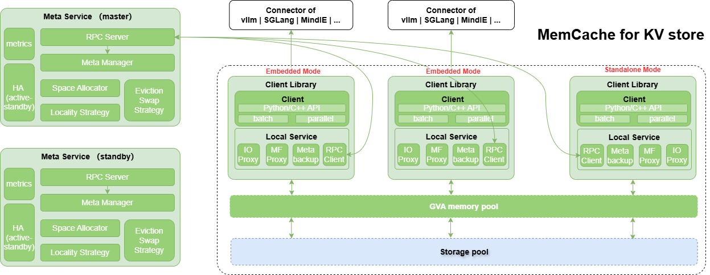
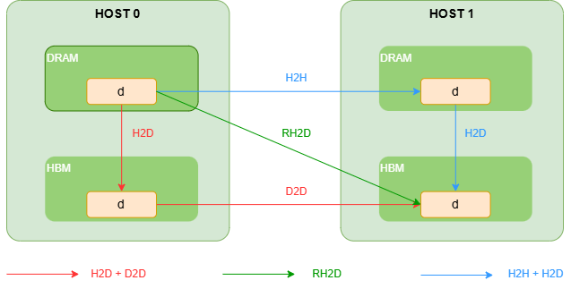
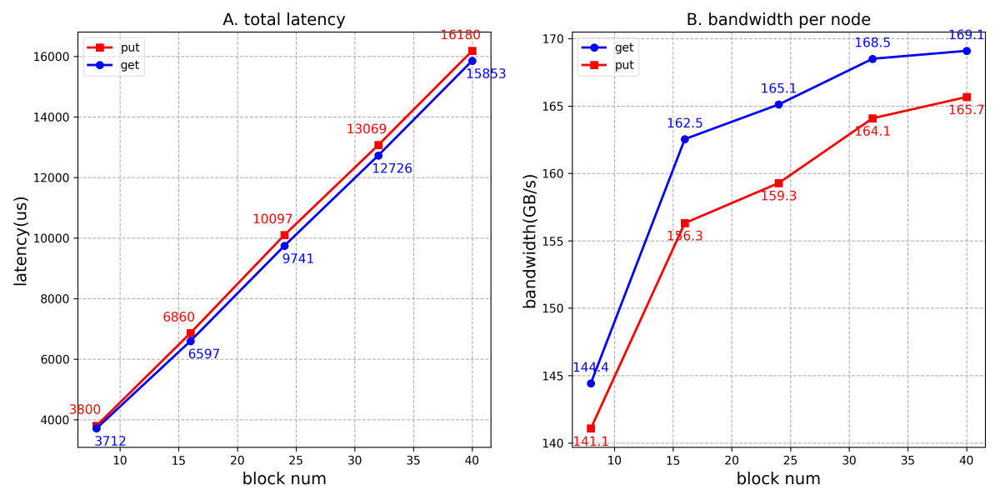
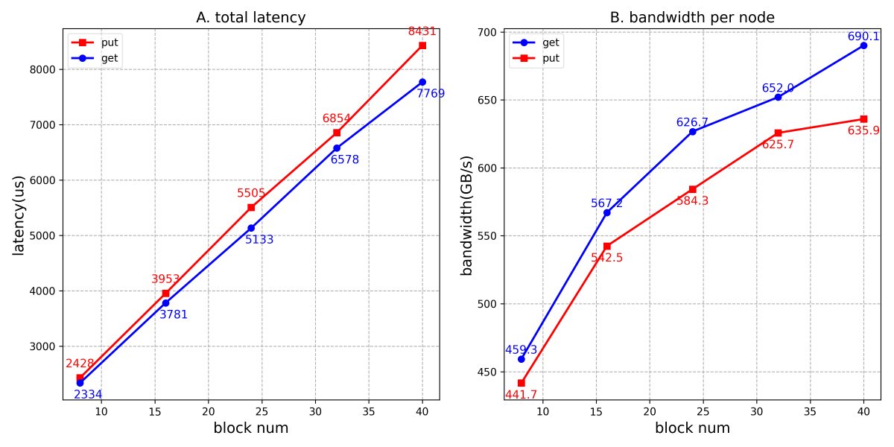

<h1 align="center" style="margin: 0;"></h1>
<div align="center">

  <hr style="display:block; border:none; height:0; border-top:2px solid #008000; width:100%; max-width:1250px; margin:20px auto;">
  <h2 align="center">
High-performance distributed key-value cache
  </h2>

[](https://ascend-memcache.readthedocs.io/zh-cn/latest/)
[](https://pypi.org/project/memcache-hybrid/#history)
[](https://pypi.org/project/memcache-hybrid/)
[](https://pypi.org/project/memcache-hybrid/)
[](https://gitcode.com/Ascend/memcache/analysis)
[](https://gitcode.com/Ascend/memcache/blob/master/LICENSE)

</div>
<br/>

## 🔄Latest News

- [2026/06] MemCache使能推理PrefixCache加速案例实践，请关注[wiki主页案例库](https://gitcode.com/Ascend/memcache/wiki/Home.md)获取最新案例
- [2025/12] MemCache已作为vllm-ascend backend使能大模型推理加速，详情查看vllm-ascend开源社区，[使用示例](https://docs.vllm.ai/projects/ascend/en/v0.27.1rc1/user_guide/feature_guide/kv_pool.html#example-of-using-memcache-as-a-kv-pool-backend)

- [2025/11] MemCache项目于2025年11月开源，开源社区地址为：<https://gitcode.com/Ascend/memcache>

## 🔜 Roadmap&发布策略

MemCache roadmap详见：[**Roadmap**](https://gitcode.com/Ascend/memcache/wiki/Roadmap.md)
MemCache 分支发布策略：[**分支发布策略**](https://gitcode.com/Ascend/memcache/wiki/%E5%BC%80%E5%8F%91%E4%B8%8E%E5%8F%91%E5%B8%83%E8%8A%82%E5%A5%8F%E5%8E%9F%E5%88%99.md)

## 🎉概述

MemCache是针对LLM推理、GR推理场景设计的高性能分布式KVCache存储引擎，其主要特性包括：

- **基于对象操作的API**：支持批量和非批量的put/get/exist/remove操作，支持多层结构的KV Block读写接口。
- **多层缓存池**：支持HBM，DDR，SSD组成多级缓存池，多级之间通过淘汰和预取进行数据冷热交换。
- **高带宽低时延**：使用 [MemFabric](https://gitcode.com/Ascend/memfabric_hybrid)
  作为多级内存和异构网络传输的底座，在Ascend硬件上，基于device_rdma(A2)、device_sdma(A3)、host_rdma(A2/A3)、device_urma(A5)
  等路径提供OneCopy跨机跨介质数据直接访问能力，满足高带宽，低时延的读写性能诉求。在鲲鹏硬件上，支持host_urma(K5)。支持host_shm实现同节点共享内存通信。
- **支持扩缩容**：支持LocalService动态加入和移除
- **HA能力**：在K8S集群中，MetaService支持多活能力，支持元数据恢复，提供尽力而为的HA能力。

<div align="center">
  
</div>

## 🧩核心组件

MemCache包含LocalService和MetaService两大核心组件：

- **MetaService**：
  - 负责管理整个集群中内存池空间的分配和管理，处理LocalService的加入与退出。
  - MetaService作为独立进程运行，提供两种启动方式：python API启动；二进制启动，详见 [whl安装使用](./docs/zh/install_whl.md) 和 [run安装使用](./docs/zh/install_run.md)
  - MetaService支持两种部署形态：
  ***1、单点模式***：MetaService由单个进程组成，部署方式简单，但存在单点故障的问题。如果MetaService进程崩溃或无法访问，系统将无法继续提供服务，直至重新恢复为止。
  ***2、HA模式***：该模式基于K8S的ClusterIP Service和Lease资源构建，部署较为复杂，该模式会部署多个MetaService进程实例，实现多活高可用。部署详见[怎么部署一个MemCache的HA集群](https://gitcode.com/Ascend/memcache/wiki/%E6%80%8E%E4%B9%88%E9%83%A8%E7%BD%B2%E4%B8%80%E4%B8%AAmemcache%E7%9A%84HA%E9%9B%86%E7%BE%A4.md)

- **LocalService**：负责承担如下功能：
  - **客户端**：作为客户端，以whl/so形式作为共享库被应用进程加载调用API
  - **内存提供者**：负责提供一段连续的内存区域作为内存池空间的一部分，其内存可以被其他LocalService实例基于地址直接访问。

### 📁项目结构导览

MemCache 核心代码按模块化设计原则组织，核心实现位于 `src/memcache/csrc` 下。

```text
src/memcache/csrc/                        # C++ 核心实现
  ├── meta_service/                       # MetaService：集群元数据管理、空间分配、淘汰
  │    ├── mmc_meta_service.cpp           # MetaService 主服务逻辑
  │    ├── mmc_meta_manager.cpp           # 元数据管理器（key→blob 全局映射）
  │    ├── mmc_blob_allocator.cpp         # 内存池空间分配器
  │    ├── mmc_meta_container_lru.cpp     # LRU 元数据容器（冷热追踪/淘汰）
  │    └── mmc_meta_net_server.cpp        # RPC 网络服务端
  ├── client/                             # 本地客户端：被推理进程以 whl/so 形式加载
  │    ├── mmc_client_default.cpp         # 客户端核心实现（batch put/get/copy）
  │    ├── mmc_meta_net_client.cpp        # RPC 网络客户端
  ├── local_service/                      # LocalService：内存提供者
  │    ├── mmc_local_service_default.cpp  # LocalService 主实现
  │    └── mmc_bm_proxy.cpp               # MemFabric BM 语义代理
  └── under_api/                          # 底座接入层（MemFabric / UBSIO）
       ├── mf_smem/                       # MemFabric 动态库接入（HBM / DRAM 层）
       │    └── smem_bm_api.cpp           # 批量内存拷贝 API
       └── ubs_io/                        # UBSIO 动态库接入（SSD 层）
            ├── mmc_ubs_io_proxy.cpp      # UBSIO 代理封装
            └── dl_ubsio_api.cpp          # UBSIO 动态加载
```

## 🔥性能表现

MemCache核心能力是提供大容量内存池和高性能的H2D、D2H、**D2RH、RH2D**数据访问能力，由于MemCache以 [MemFabric](https://gitcode.com/Ascend/memfabric_hybrid) 作为池化底座，所以支持RH2D、D2RH等OneCopy跨机跨介质数据直接访问能力，下图为RH2D对比其他中转路径的对比示意图。
<div align="center">
  
</div>

基于OneCopy跨机跨介质数据直接访问的能力，MemCache在A2/A3做了相关性能测试如下：
模拟构造DeepSeek-R1模型KV大小的block，单个block size为：61x128K + 61x16K = 8784KB ≈ 8.57MB，共122个离散地址。

- 使用2个昇腾A2节点（每节点8张卡）组成双机内存池进行读写测试性能如下：

<div align="center">
  
</div>

- 使用2个昇腾A3节点（每节点8张卡16Die）组成双机内存池进行读写测试性能如下：

<div align="center">
  
</div>

## 🚀快速入门

请访问以下文档获取简易教程：

- 安装使用：[whl安装和使用](./docs/zh/install_whl.md)（适用于Python用户），[run编译、安装和使用](./docs/zh/install_run.md)（适用于C++用户）
- [配置文件](docs/zh/memcache_config.md)：涉及MetaService、LocalService公共配置
- [样例执行](./example/examples.md)：介绍如何端到端执行样例代码，包括C++和Python样例
- [DevContainer 远端开发](./docs/zh/devcontainer_quickstart.md)：VS Code Remote-SSH + DevContainer 一站式开发环境搭建与全量示例运行指南

## 📑学习教程

- [C++接口](docs/zh/memcache_c++_api.md)：C++接口介绍以及C++接口对应的API列表
- [Python接口](docs/zh/memcache_python_api.md)：Python接口介绍以及Python接口对应的API列表
- [RESTful接口](docs/zh/memcache_restful_api.md)：指标监控接口介绍以及API列表

## 📦软件硬件配套说明

- MemCache软件依赖 [MemFabric](https://gitcode.com/Ascend/memfabric_hybrid)，相关配套与MemFabric相同。 详见：[完整软件硬件配套文档](./docs/zh/compatibility.md)，涵盖支持的操作系统、Ascend/鲲鹏硬件型号、CANN版本、MemFabric底座版本、内存大页规格等完整配套信息。

## 📌FAQ

常见问题请参考：[FAQ](https://gitcode.com/Ascend/memcache/wiki/FAQ.md)

## 📝相关信息

- [安全声明](./docs/zh/SECURITYNOTE.md)

- [许可证](./LICENSE)

## 说明

此开源项目非华为产品，仅提供有限支持。
