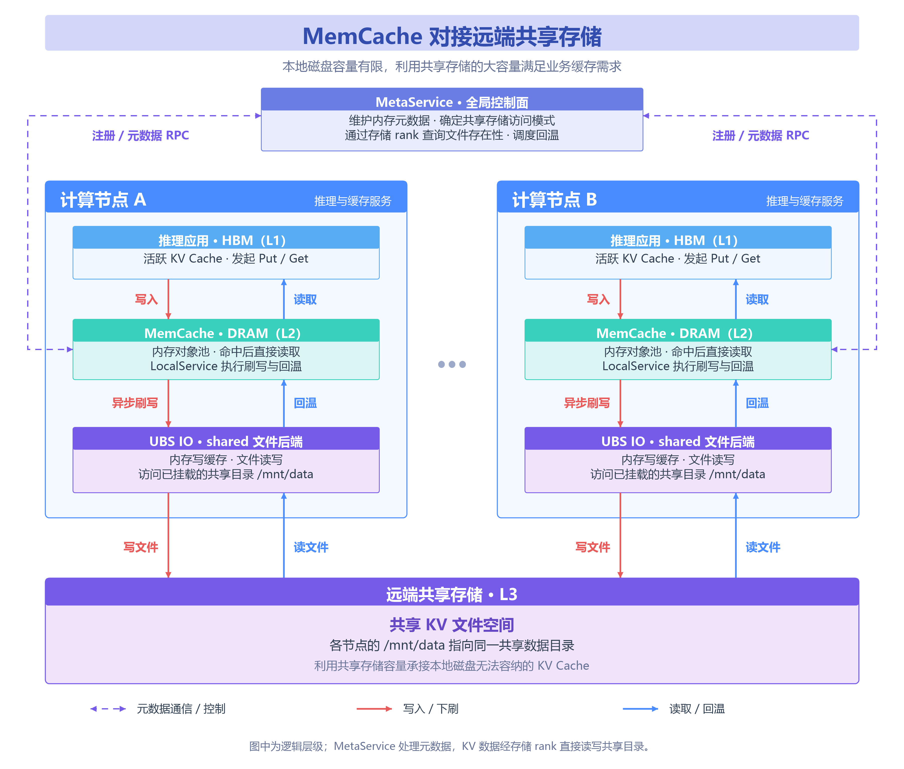

# 对接远端共享存储

## 1. 背景与动机

计算节点的本地磁盘容量有限。随着推理业务的上下文长度、并发请求和缓存保留规模增长，需要保存的 KV Cache 可能超出本地磁盘能够提供的空间，难以满足业务对缓存容量的需求。

对于已经具备远端共享存储的环境，MemCache 可以利用共享存储的大容量保存 KV Cache，将缓存容量扩展到计算节点本地磁盘之外。多个计算节点接入同一个共享数据目录，在内存中保留热点数据，将可复用的缓存数据保存到共享存储，在后续请求需要时回温使用。

**适用场景：**

- **本地磁盘容量不足**：单节点可用磁盘空间无法容纳业务所需的 KV Cache。
- **缓存规模持续增长**：长上下文、多轮对话等业务需要保存更多可复用数据，利用共享存储容量承接增长需求。
- **已有大容量共享存储**：复用现有存储资源，为多个计算节点提供统一的 KV Cache 存储空间。

## 2. 三级缓存架构

MemCache 通过 UBS IO 文件后端接入已挂载的共享存储。各计算节点保留 HBM 和 DRAM 缓存，共享存储提供大容量文件存储层；MetaService 负责元数据管理和调度。



- **写入路径**：应用写入 MemCache DRAM，后台经 UBS IO 异步刷写到共享目录。
- **读取路径**：内存命中时直接读取；内存副本释放后，经 UBS IO 从共享存储回温到 DRAM，再提供给应用。
- **元数据管理**：`shared` 类型启用元数据分离，由存储 rank 查询文件后端的数据存在性。KV 数据通过存储 rank 读写共享目录。

应用继续使用 `Put` / `Get` 等接口，缓存数据所在的层级由 MemCache 管理。

## 3. 部署

本文假设用户已有可用的共享存储，并已挂载到当前节点的 `/mnt/data`，应用进程可以读写该目录。同一 MemCache 集群的存储节点访问同一份共享数据。

### 3.1 安装

本特性依赖存储 rank 注册时自动上报 `shared` 模式。请在包含该功能的 MemCache `master` 源码根目录执行 `bash script/build_and_pack_run.sh`，安装生成的 MemCache 包和配套的 MemFabric。UBS IO 随 MemCache 安装包集成。

### 3.2 修改配置文件

以下给出单个计算节点上 MetaService 与一个 LocalService 的最小运行配置。两者在同一主机运行，使用 `host_shm` 通信，共享存储已挂载到 `/mnt/data`。将两份配置文件保存到当前工作目录。

#### 配置文件 `mmc-local.conf`

```ini
ock.mmc.meta_service_url = tcp://127.0.0.1:5000
ock.mmc.local_service.config_store_url = tcp://127.0.0.1:6000
ock.mmc.local_service.protocol = host_shm
ock.mmc.local_service.dram.size = 2GB
# 仅当 ock.mmc.local_service.dram.size 不为 0 时，才能开启下述存储配置。
ock.mmc.local_service.storage.enabled = true

ubsio.mem.size_in_gb = 10
ubsio.underfs.file_system_type = shared
ubsio.underfs.local.root_path = /mnt/data
```

| 参数 | 配置值 | 说明 |
| --- | --- | --- |
| `ock.mmc.meta_service_url` | `tcp://127.0.0.1:5000` | MetaService 地址，与 `mmc-meta.conf` 保持一致 |
| `ock.mmc.local_service.config_store_url` | `tcp://127.0.0.1:6000` | 配置存储服务地址，与 MetaService 的配置存储地址保持一致 |
| `ock.mmc.local_service.protocol` | `host_shm` | 使用同一主机内的共享内存通信 |
| `ock.mmc.local_service.dram.size` | `2GB` | 本 LocalService 的 MemCache DRAM 容量 |
| `ock.mmc.local_service.storage.enabled` | `true` | 启用 UBS IO 存储链路 |
| `ubsio.mem.size_in_gb` | `10` | 本进程的 UBS IO 内存池容量，单位 GB，独立于 MemCache DRAM |
| `ubsio.underfs.file_system_type` | `shared` | 使用共享文件后端，MemCache 据此启用元数据分离 |
| `ubsio.underfs.local.root_path` | `/mnt/data` | 应用进程可读写的共享目录；`shared` 沿用该配置项名称 |

MemCache 将加载的 LocalService 配置文件传给 UBS IO，因此 `ubsio.*` 参数也写在 `mmc-local.conf` 中。`ubsio.disk.path` 默认值为空，本例无需显式配置。运行环境需为本进程预留 2 GB MemCache DRAM、10 GB UBS IO 内存及应用和系统所需空间。

#### 配置文件 `mmc-meta.conf`

```ini
ock.mmc.meta_service_url = tcp://127.0.0.1:5000
ock.mmc.meta_service.config_store_url = tcp://127.0.0.1:6000
ock.mmc.meta_service.metrics_url = http://127.0.0.1:8000
```

前两项分别提供元数据服务和配置存储服务地址，`metrics_url` 提供验证时使用的统计接口。MetaService 根据存储 rank 注册时上报的信息确定元数据模式，无需配置元数据分离开关。

多计算节点部署时，将服务地址中的 `127.0.0.1` 替换为实际可达地址，并选用支持跨节点通信的协议；各存储节点保持 `shared` 类型和共享数据目录一致。

## 4. 限制与注意事项

- **共享目录一致性**：所有存储节点必须访问共享存储上的同一个数据目录。相同的路径字符串不代表相同的数据目录。不同 MemCache 集群应使用独立的数据目录，避免相同 key 相互覆盖。
- **元数据模式一致性**：同一 MetaService 下的存储 rank 使用一致的模式，模式不一致的 rank 会被拒绝注册。调整模式时统一更新配置并重启相关服务。
- **文件系统容量自动淘汰不可用**：当前文件后端不提供按共享文件系统容量自动淘汰数据的机制。需规划容量、监控空间和 inode，并在停止相关业务后清理不再使用的数据。
- **资源与性能**：UBS IO 仍需使用计算节点内存，共享存储的带宽、延迟和可用性也会影响刷写及回温，应结合实际负载进行容量与性能规划。
- **缓存生命周期**：共享文件后端保存的数据属于缓存，文件存在不等于完整的故障恢复能力。

## 5. FAQ

### 1. 为什么初始化日志中仍出现 `Local underfs`？

`shared` 复用文件读写实现，因此初始化成功日志仍使用 `Local underfs` 文本。应结合实际配置值确认类型，本例对应的关键文本如下：

```text
ubsio.underfs.file_system_type = shared
ubsio.underfs.local.root_path = /mnt/data
Local underfs initialize success, rootPath:/mnt/data/v1.
```

UBS IO 在配置的根目录下管理 `v1` 文件布局，`root_path` 填写 `/mnt/data` 即可。

### 2. 配置为 `shared` 后，为什么存储 rank 注册失败？

检查同一 MetaService 下其他存储 rank 的模式，确认均使用 `shared`，并核对实际加载的配置文件和 UBS IO 动态库。`local` 及其他类型按元数据聚合模式处理。

### 3. 为什么 Put 返回成功后，共享目录中尚未出现文件？

数据通过后台异步刷写到共享存储。检查刷写结果、文件后端错误及共享目录剩余容量，等待目标文件完整写入后再验证回温。

可通过 MetaService 的 `/metrics/summary` 观察 `flush_bytes`、`rewarm_bytes_total` 和 `rewarm_fail`，具体定义参见 [RESTful API](../../../memcache_restful_api.md)。MemCache 指标中的 `ssd` 命名表示存储层，本例对应远端共享存储。
